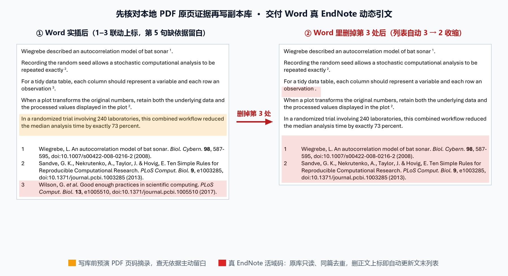

# Editable EndNote Citations for Word (`dsh-plugin-endnote-cwyw`)

[简体中文](README.md) · English · [Workflow & Troubleshooting](skills/cite-from-pdfs/references/workflow-and-troubleshooting.md) · Original `.enl`, PDFs & DOCX stay read-only

**Preview every `[+Cite]` sentence anchor, verbatim PDF page excerpt, and reuse-vs-import library diff before touching anything—then merge new papers with attached PDFs into an isolated `.enl + .Data` copy and deliver genuine Word EndNote CWYW citations you can delete, add, or restyle anytime.**



## What to ask your assistant

| Goal | Prompt (provide manuscript, PDF folder & `.enl` path) |
| --- | --- |
| Preview placements & PDF pages first | “Use cite-from-pdfs to preview citations for `Draft.docx` using `Papers/` and `Library.enl`. Show `[+Cite]` sentence previews, PDF pages, verbatim quotes, and reuse vs add decisions before editing the library.” |
| Deliver live Word + library copy | “Apply the approved plan on copies and deliver `manuscript_cwyw.docx`, its matching `.enl + .Data` copy, and the audit report.” |
| Convert or repair CWYW fields | “Inspect citation fields in `Draft.docx` and convert static citations into refreshable EndNote CWYW fields on a copy.” |

## Why it exists, what it does & verified results

- **Deterministic Word + EndNote automation without risking your library**: Bare AI runs over desktop Word and EndNote often burn 6–9 throwaway scripts and fail on COM, CWYW field syntax, or multi-library focus clashes. This plugin locks every run to timestamped copies, leaving your original `.enl`, `.Data`, PDFs, and DOCX untouched.
- **Page-grounded preview & offline PDF parsing**: Reads two-column PDFs across up to `--max-pages 30`, filters publisher header slugs, extracts all page-1 authors offline, matches journal abbreviations and `±1` Epub years, flags all edited/missing draft sentences in one batch pass, and refuses to fabricate citations for unsupported claims.
- **Exact punctuation placement & live CWYW updates**: Places English Nature citations directly after `.` with zero space (`result.²`), Chinese citations before `。` (`结果²。`), and attaches full-text PDFs on copy import (`2/2` vs `0/2` bare). Deleting or reinserting citations inside Word + EndNote 21 updates the bibliography live (`3 → 2 → 3` and `2 → 1 → 2`).
- **Zero false merges on public deduplication benchmarks**: Achieved **100% precision (0 false merges)** across CoLRev’s 1,292-record stroke and 1,415-record haematology sets (`93.1%` / `57.6%` recall, routing ambiguous pairs to manual review). *(Note: importing into `.enl` and refreshing CWYW fields requires an interactive Windows desktop with Microsoft Word and EndNote.)*

## Install (Windows Word + EndNote, Python 3.10+)

Close EndNote cleanly before running:

```powershell
dsh plugin --profile web add (Resolve-Path '.\dsh-plugin-endnote-cwyw-0.3.0.tgz').Path
```

[Desktop Evaluation](docs/evaluation.md) · [Benchmarks](docs/comparison.md) · [Related Tools](docs/landscape.md) · [MIT License](LICENSE)
