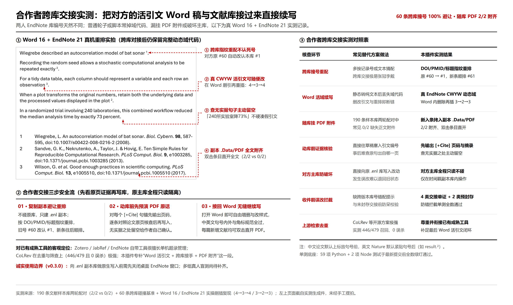

# EndNote 引文与跨库交接助手 (`dsh-plugin-endnote-cwyw`)

[English](README.en.md) · [排障与完整流程](skills/cite-from-pdfs/references/workflow-and-troubleshooting.md) · 原稿、主 `.enl` 库与 PDF 全程只读

专为**“合作者交接带活引文的 Word 稿 + 文献库，接手人库编号不同还要继续改稿、删插引文和开 PDF 附件”**以及**“按本地 PDF 原页原话补引文”**打造——先对齐真实文献身份与原页证据，再在独立 `.enl + .Data` 副本上交付可编辑的 **Word 真 EndNote 动态引文**，并把全文 PDF 一并挂齐在副本库里。



## 我们重点补齐了什么（以及已有工具能做什么）

市面上已经有不少顺手的轮子：少量定点插引可以直接用 Clarivate 官方 Word 插件 `CWYW` 和 `Quote & Cite`；单库自动插活引文与重开验证已有 `felimet/endnote-for-word` 和 `Breathay/endnote-cwyw`；从 DOI 标记或特定格式转活域已有 `PubMate`、`Gaoyuan`、`wmyung`；如果团队能整体切换文献管理器，`Zotero` 和 `Citavi` 也非常成熟。

本插件不跟“单库普通插引”硬拼，把优势集中在**合作者跨电脑、跨文献库交接不断链**和**动库前逐页核对依据**：

- **1. 合作者发来带活引文的 Word 稿和不同编号的文献库，接手人照样安全续写、删插与开附件**：
  - **真身份重绑，不被相同记录号骗过**：不同电脑的 EndNote 库记录号常常对不上（原稿 `#60` 在接手人库里可能是另一篇论文），仅靠 Word 随行库（Traveling Library）点“更新书目”或核对文件哈希（`6/6` 一致）都拦不住底层错配。插件按 DOI、PMID 与题名/作者/年份核验文献真实身份（兼容刊名缩写与 `±1` 年），在 60 条跨库碰撞试验中自动把 `#60` 重绑回 `#1`、复用缺 DOI 拼写变体 `#2`、仅新增缺失条目 `#61`，原有 60 条记录 `0` 改动，并在 Word 16 + EndNote 21 实测删引重插通过 `4 → 3 → 4` / `3 → 2 → 3`；检测到同进程打开无关库时自动熔断防误写。
  - **新增文献自动随副本库挂齐全文 PDF**：同稿对照试验中，插件组 `2/2` 次都将新增文献 PDF 挂载到副本库 `.Data/PDF`，而普通工具组 `0/2` 次未随库附齐——接手人在 EndNote 里双击条目就能直接打开原文核对。
- **2. 动库前先看 PDF 原页原话，无据句子绝不硬塞**：
  - 离线扫描双栏 PDF（最多前 30 页），逐句列出 `[+Cite]` 插点、物理页码和原话摘录；原稿已被删改找不到的句子一次标全，PDF 查无实据之处主动留白不瞎编。


- **3. 完全不碰你的主文献库，精准去重 + 真活域交付**：
  - 所有导入与判同只在时间戳 `.enl + .Data` 副本上完成（2,707 条公开书目去重基准 **0 误合并 / 100% 查准率**），并调用本机官方 EndNote CWYW 写入动态域——英文 `Nature` 紧贴句号后零空格（`result.²`），中文置于全角句号前（`结果²。`）。

## 怎么用

1. 先**关闭 EndNote 桌面窗口**再安装（需本地 Windows 版 Word + EndNote 及 Python 3.10+）：

```powershell
dsh plugin --profile web add (Resolve-Path '.\dsh-plugin-endnote-cwyw-0.3.0.tgz').Path
```

2. 把稿件、PDF 文件夹和 `.enl` 路径直接发给 AI：

| 你要做的事 | 直接这样说 |
| --- | --- |
| **合作者跨库接力续写 + 挂附件** | “合作者发来已有活引文的《交接稿.docx》和文献文件夹 `Papers`，我本地库是 `MyLib.enl`（记录号不同）。请用 endnote-cwyw + cite-from-pdfs 核对旧引文真实身份并重绑到副本库、补齐缺失文献与 PDF 附件，交付可继续删插和开附件的成对副本。” |
| 先核对插点与 PDF 原页 | “用 cite-from-pdfs 为《文稿.docx》预演加引文：PDF 在 `Papers`，EndNote 库是 `Library.enl`。先列目标句 `[+Cite]` 位置、对应 PDF 页码摘录和复用/新增明细，再动手写库。” |
| 确认后交付成稿与副本库 | “按确认方案在独立副本上写库加引文，把可编辑 Word、配套 `.enl + .Data` 副本库与检查报告交给我。” |
| 把静态引用转为活域码 | “用 endnote-cwyw 检查《文稿.docx》的域代码，在副本上转换成可被 EndNote 实时刷新的动态引文。” |

[桌面验证实录](docs/evaluation.md) · [基准对比](docs/comparison.md) · [同类方案对比](docs/landscape.md) · [MIT License](LICENSE)
