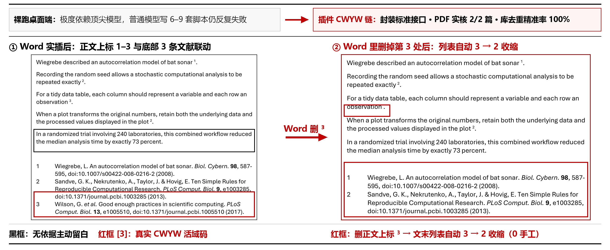

# EndNote 引文助手：给 Word 增补可编辑引文 (`dsh-plugin-endnote-cwyw`)

[English](README.en.md) · [完整工作流](skills/cite-from-pdfs/references/workflow-and-troubleshooting.md) · 原稿、原 `.enl` 文献库与 PDF 全程只读

**让通用 AI 直接操纵桌面端 Word 与 EndNote，往往在 COM 接口、域码语法或双库焦点冲突上反复试错仍失败，还伴随写脏主文献库的风险；批量插进正文的引文也常让人分不清究竟对应哪一页 PDF 原文。本插件把整条链固化为先预演证据、再于时间戳副本写库、最终调用官方 EndNote CWYW 交付真活域码的可控流程。**



## 核心工作流与桌面实测

- **原库、PDF 与 Word 原稿全程只读**：跳过直接操作主 `.enl` 的高风险路径，所有读写与合库全部在时间戳独立副本（`.enl + .Data` 与副本 `.docx`）上执行；告别通用模型裸跑连写 6–9 套临时脚本仍失败的不确定性。
- **逐句先看 PDF 原页依据，无据断言克制留白**：无网离线扫描本地 PDF（自动过滤页眉排版代号、首页提全作者、按双栏顺序读取最多前 30 页，支持常见刊名缩写与跨年 `±1` 匹配）；批量预演一次标出正文已被删改句子与缺失摘录，把 `[+Cite]` 插点、物理页码和原页摘录摊开核对，PDF 查无依据之处留空不硬塞。
- **期刊标点精确定位 + 真 EndNote 动态域联动**：英文 `Nature*` 样式下引文紧贴句号后零空格（`result.²`），中文置于全角句号前（`结果²。`），支持曲引号与批注段落；在 190 条样本库实测中，同篇或改名 PDF 自动合库去重只增 1 条并随库附齐 **`2/2` 全文附件**（裸跑对照屡次漏附），在 Word + EndNote 21 内直接删掉第 3 处引文并刷新，正文上标与文末参考文献列表随之 **`3 → 2 → 3`**（及 `2 → 1 → 2`）实时收缩恢复。
- **零误合并的大规模书目去重基准**：在 CoLRev 公开的卒中（`1,292` 条）与血液学（`1,415` 条）书目去重数据集上，自动判同精确率 **`100%`（`0` 误合并）**，模糊临界条目单列供人工复核。*注：写库与刷新 CWYW 动态域需在本地 Windows 桌面环境运行 Microsoft Word 与 EndNote。*

## 常用对话示例

| 你的需要 | 发给助手（附稿件、PDF 目录和 `.enl` 路径） |
| --- | --- |
| 先核对插点位置与 PDF 原页证据 | “用 cite-from-pdfs 为《文稿.docx》预演加引文：PDF 在 `Papers`，EndNote 库是 `Library.enl`。先列目标句 `[+Cite]` 位置、对应 PDF 页码摘录和复用/新增明细，再执行写库。” |
| 确认后交付可编辑 Word + 副本库 | “按确认方案在独立副本上写库加引文，把可编辑 Word、配套 `.enl + .Data` 副本库与检查报告一起交给我。” |
| 静态引文转为真 CWYW 动态域 | “用 endnote-cwyw 检查《文稿.docx》的域代码，在副本上转换成可被 EndNote 实时刷新的动态引文。” |

## 安装说明

关闭 EndNote 桌面窗口后执行（Windows Word + EndNote，Python 3.10+，缺依赖时可运行 `conda run -n base python -m pip install -r requirements.txt`）：

```powershell
dsh plugin --profile web add (Resolve-Path '.\dsh-plugin-endnote-cwyw-0.3.0.tgz').Path
```

[桌面验证实录](docs/evaluation.md) · [基准对比实验](docs/comparison.md) · [同类工具对比](docs/landscape.md) · [MIT License](LICENSE)
