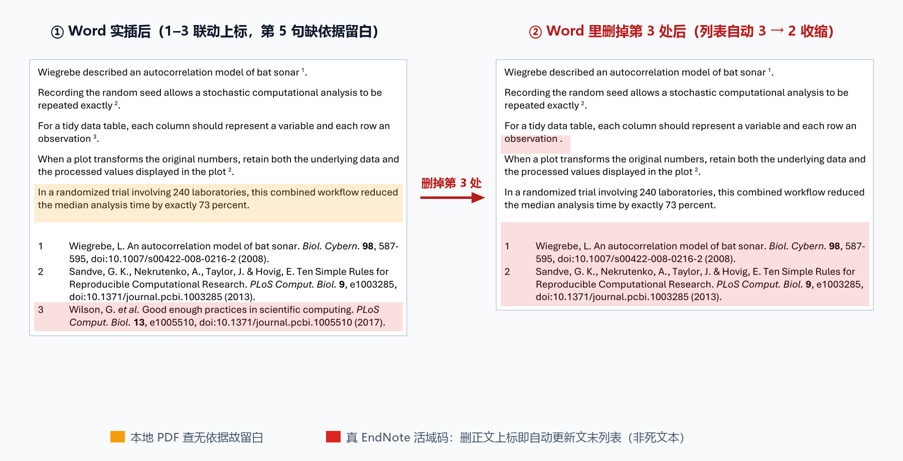

# EndNote 真引文助手 · dsh-plugin-endnote-cwyw

[English](README.md) · [裸跑与开源对照实测](docs/comparison.md) · [桌面端实机验收](docs/evaluation.md) · [同类调研](docs/landscape.md)

[](https://github.com/Spark-xY6/dsh-plugin-endnote-cwyw/actions/workflows/checks.yml?query=branch%3Amain) · [v0.1.0 发布验证](https://github.com/Spark-xY6/dsh-plugin-endnote-cwyw/actions/runs/44836288185)

手头有一份刚写到一半的 Word 草稿、一文件夹参考 PDF 和一个用久了的 EndNote 文献库，交给它就行。插件会逐页在本地 PDF 里找支持每一句话的原文依据，去重并对齐你旧库里的编号（不再把“记录 60”张冠李戴成合作者库里的另一篇），把缺的文献连同全文 PDF 一起补进库副本，最后调官方 EndNote 在 Word 中插好真正联动的引文域——合作者打开文档直接在 Word 里删插条目，文末列表也会跟着实时重排。

## 为什么不直接让 AI 裸跑操作桌面端？

用普通模型直接写临时脚本去控制电脑上的 EndNote 与 Word，几乎每步都在碰运气：窗口焦点切换、CWYW 域码编码、PDF 挂接和同进程多库窗口冲突，只要一环出错就会卡死循环，反复改 `6–9` 套脚本最后依然失败；即便是能力很强的旗舰模型裸跑两轮对比，也全部漏掉了往交付库里附加全文 PDF（`0/2`）。

`dsh-plugin-endnote-cwyw` 把这一长串桌面暗坑固定成了确定步骤，普通模型也能一步跑通。下图来自同一篇通用英文稿在真实 Word 16 + EndNote 21 中的导出前后：



## 实测数据与客观边界

- **真联动与全文附齐**：在 Word 16 + EndNote 21 端到端对比中，插件交付件全部带上可编辑的 `EN.CITE` + `EN.REFLIST` 域码，实测“在 Word 中删 1 条 -> 保存重开 -> 再插回”列表自动从 `3 -> 2 -> 3`（以及 `4 -> 3 -> 4`）联动闭环，且 `2/2` 篇新引文献的全文 PDF 完整入库（SHA-256 逐字节一致），第二轮 `0` 份残留脚本。
- **跨库防撞号与双库安全锁**：跨库测试中将合作者旧稿里的 `#60` 自动重绑回正确 `#1`，复用缺 DOI 且题名微误的 `#2`，全程仅在库副本执行；当检测到同一 EndNote 进程还开着另一份库时直接拒绝写入，保护主库不被误改。
- **去重召回边界**：在 `stroke` 与 `haematology` 两个缺乏 DOI/PMID 的公开大型历史书目去重基准上，本插件自动判重**精准率 100%**（零误合并），召回率为 `93.11%` 与 `57.58%`——如果你的库极庞大且大多缺少标识符，建议配合专业去重工具 `BibDedupe`（同数据集召回 `99.58% / 83.03%`）先行清理。原始实测数据见 [docs/comparison.md](docs/comparison.md)。

## 1 分钟安装与使用

需要安装有桌面 **Microsoft Word + EndNote（实测 EndNote 21 + Word 16）** 的 Windows 电脑、Python 3.10+ 与 DeepSeek Harness（实测 `0.2.2-rc.5`）：

```powershell
git clone --branch v0.1.1 https://github.com/Spark-xY6/dsh-plugin-endnote-cwyw.git
cd dsh-plugin-endnote-cwyw
python -m pip install -r requirements.txt
dsh plugin --profile web add github:Spark-xY6/dsh-plugin-endnote-cwyw#v0.1.1
```

重启 DSH 后，先保存 Word 并关掉桌面 EndNote，把输入文件放在仓库外目录，复制下面这段发给助手即可：

> 请使用 cite-from-pdfs。PDF 文件夹在「文献目录」，旧库是「库文件.enl」（同名 .Data 在同级目录），稿件是「稿件.docx」。请逐句核对 PDF 原文页码后再决定引用，缺乏依据的句子留空并标注，同一论文尽量复用已有记录。全程只在副本上执行，给我交付带 EndNote 真域的 Word、配套更新库和待复核清单。

只想先看匹配方案、暂不写库，句尾加上 **“先只做预演（preview only）。”** 即可。拿到交付物后请**先双击打开交付目录里的 `.enl` 库，再打开 `manuscript_cwyw.docx`**；转交合作者时别忘了把 `.docx`、`.enl` 和同名 `.Data` 文件夹一起打包。

更多操作细节见 [docs/evaluation.md](docs/evaluation.md)、[docs/landscape.md](docs/landscape.md) 与 [workflow-and-troubleshooting.md](skills/cite-from-pdfs/references/workflow-and-troubleshooting.md)。默认全本地运行（仅显式启用联网元数据补全时才会按题名/DOI 查询 Crossref/OpenAlex/PubMed）；源代码基于 [MIT 协议](LICENSE)。
